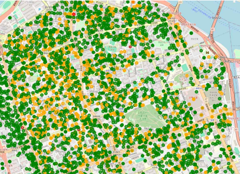

# 서울시 침수 위험도 분석 (Seoul Flood Risk)

2023·2024년 서울시 **침수흔적도**와 기상청 **방재기상관측(AWS)** 데이터를 결합해,
실제 침수가 발생한 지점의 지형·강수 조건을 분석하고 **위험도(상·중·하)** 를 산정한 프로젝트입니다.
공모전 참가 당시 Jupyter 노트북으로 진행한 분석을, 처음부터 끝까지 다시 실행할 수 있는 파이프라인으로 정리했습니다.

## 주요 내용

- **Selenium 크롤링**: 기상청 날씨누리 AWS 페이지에서 침수 발생일의 일극값·시간별 관측 자료 수집
- **공간 데이터 처리**: 침수흔적 폴리곤(SHP)의 중심점 좌표 계산, 좌표계 변환(GeoPandas)
- **최근접 매칭**: KDTree + Haversine 거리로 침수 지점마다 가장 가까운 등고선·관측소 값 결합
- **위험도 모델링**: 지형(표고)·강수·습도를 점수화한 규칙 기반 위험 등급 산정
- **시각화**: folium으로 위험도별 침수 지점 지도 생성

## 분석 흐름

```
 [1] AWS 일극값 크롤링 ──────────┐
 침수흔적도 (SHP) ───────────────┤
 등고선 (SHP) ───────────────────┼─▶ [2] 전처리 ─▶ tidy.csv
 기상청 관측지점 정보 (CSV) ─────┘        │
                                          ▼
                    [3] AWS 60분 간격 크롤링 (구·날짜별 시간당 최대 강수·습도)
                                          │
                                          ▼
                    [4] 위험도 산정 ─▶ complete.csv ─▶ [5] 지도 ─▶ map.html
```

| 단계 | 파일 | 내용 |
|---|---|---|
| 1 | `src/step1_daily_rain.py` | 침수 발생일 18일의 서울 전체 AWS **일극값** 크롤링 → 관측소 좌표·해발고도 결합 |
| 2 | `src/step2_preprocess.py` | 침수 지점 중심점 계산 → 최근접 **등고선 높이**, 최근접 관측소 **해발고도**, 같은 날 최근접 관측소 **일강수량** 결합 |
| 3 | `src/step3_hourly_rain.py` | (자치구, 날짜)별 AWS **60분 간격** 크롤링 → 하루 중 1시간 강수량 최대값과 그 시각의 습도 추출 |
| 4 | `src/step4_risk_score.py` | 위험 점수 계산 및 상·중·하 등급화 |
| 5 | `src/step5_map.py` | 위험도 등급별 지도 시각화 |

공통 모듈

| 파일 | 내용 |
|---|---|
| `src/config.py` | 데이터 경로, 상수 |
| `src/aws_crawler.py` | 기상청 AWS 페이지 Selenium 크롤러 (관측 간격·날짜·지역·관측소 선택 후 HTML 저장) |
| `src/geo_utils.py` | Haversine 거리, KDTree 최근접 매칭 |

## 위험도 산정 방식

**위험 점수 = 평균표고 점수 + 습도 가중 강수 점수 + 등고선 높이 점수**

### 1) 습도 가중 시간강수량

습도가 높으면 지표가 이미 젖어 있어 빗물이 더 많이 흘러넘친다고 보고 강수량에 가중치를 줬습니다.

| 습도 | 계산 |
|---|---|
| 70% 이상 | 강수량 × (2 − 습도/100) |
| 20% 이하 | 강수량 × (1 − 습도/100) |
| 그 외 | 강수량 그대로 |

### 2) 점수표

| 침수 구역 평균표고 (m) | 점수 | 습도 가중 시간강수 (mm) | 점수 | 최근접 등고선 높이 (m) | 점수 |
|---|---|---|---|---|---|
| 12 미만 | 1 | 20 이하 | 1 | 50 이하 | 0.9 |
| 12 ~ 35 | 2 | 20 ~ 30 | 1.5 | 50 ~ 100 | 0.6 |
| 35 ~ 60 | 3 | 30 ~ 52 | 2 | 100 초과 | 0.3 |
| 60 이상 | 8 | 52 ~ 72 | 3 | | |
| | | 72 이상 | 8 | | |

### 3) 등급

| 위험 점수 | 등급 |
|---|---|
| 5.5 이상 | 상 |
| 3 이상 5.5 미만 | 중 |
| 3 미만 | 하 |

## 실행 방법

### 1. 설치

```bash
pip install -r requirements.txt
```

Chrome 브라우저가 설치되어 있어야 합니다. 크롬드라이버는 Selenium(4.6 이상)이 자동으로 맞춰줍니다.

### 2. 데이터 준비

저장소에는 원본 데이터가 포함되어 있지 않습니다. 아래 파일을 내려받아 `data/raw/` 폴더를 만들고 넣어주세요.

| 파일 | 설명 | 출처 |
|---|---|---|
| `2024_서울시_침수흔적도.shp` (+ `.shx` `.dbf` `.prj`) | 2024년 침수흔적 폴리곤 | 서울시 |
| `2023_서울시_침수흔적도.shp` (+ `.shx` `.dbf` `.prj`) | 2023년 침수흔적 폴리곤 | 서울시 |
| `N3L_F001.shp` (+ 부속 파일) | 수치지형도 등고선 (`HEIGHT` 컬럼 사용) | 국토지리정보원 |
| `dt.csv` | 기상청 관측지점 정보 (지점번호·위도·경도·노장해발고도, CP949) | 기상자료개방포털 |

### 3. 실행

```bash
python -m src.step1_daily_rain     # 크롬 창이 열리며 크롤링
python -m src.step2_preprocess
python -m src.step3_hourly_rain    # 크롬 창이 열리며 크롤링
python -m src.step4_risk_score
python -m src.step5_map
```

- 이미 받은 페이지는 건너뛰므로, 크롤링이 중간에 끊겨도 다시 실행하면 이어서 진행됩니다.
- 크롤링 없이 저장된 HTML만 다시 처리하려면 `--skip-crawl` 옵션을 붙이세요.
- 중간 결과는 `data/interim/`, 최종 결과(`complete.csv`, `map.html`)는 `data/output/`에 자동 생성됩니다.

## 침수흔적도 주요 컬럼

| 컬럼 | 의미 |
|---|---|
| `F_ZONE_NM` | 침수 지번 주소 (예: `강동구 명일동 352-12`) |
| `F_AREA` | 침수 면적 (㎡) |
| `F_AVR_HGT` | 침수 구역 평균 표고 (m) |
| `F_SAT_YMD`, `F_SAT_TM` | 침수 시작 일자·시각 |

## 정리하면서 개선한 점

공모전 당시 노트북 코드를 옮기면서 다음 문제를 바로잡았습니다. 그래서 당시 제출 결과와 수치가 일부 다를 수 있습니다.

- **일강수량 날짜 매칭**: 모든 날짜의 관측값 중 최근접 관측소를 찾아 다른 날의 강수량이 붙을 수 있었던 문제 → 같은 날짜 관측값 안에서만 매칭
- **자치구 ↔ 관측소 매칭**: 문자열 유사도만으로 찾아 '강남구'가 '성북' 관측소에 매칭되던 문제 → '구'를 뗀 이름으로 정확히 일치하는 관측소를 먼저 찾고, 없을 때만 유사도 매칭
- **중심점 좌표계**: 위경도로 변환한 뒤 중심점을 구하던 방식 → 원래 투영좌표계(m 단위)에서 구한 뒤 변환
- **크롤링 안정성**: 달력 팝업이 버튼을 가려 클릭이 실패하던 문제 처리, 한 건이 실패해도 나머지는 계속 진행
- **구조**: 노트북 간 전역변수 의존과 하드코딩된 경로를 없애고 단계별 스크립트로 분리

## 데이터 출처

- 서울시 침수흔적도 (2023, 2024) — 서울특별시
- 수치지형도 등고선 — 국토지리정보원
- 관측지점 정보 — [기상청 기상자료개방포털](https://data.kma.go.kr)
- 방재기상관측(AWS) — [기상청 날씨누리](https://www.weather.go.kr/w/observation/land/aws-obs.do)


## 결과



### 지도
- 공모전 당시 서울 강북 일부 지역의 분석 지점에 위험도 산정 기준을 적용한 결과입니다.
- 점 하나는 하나의 분석 지점이며, 색은 위험도 등급입니다.
  🟢 하 (점수 3 미만) · 🟠 중 (3 이상 5.5 미만) · 🔴 상 (5.5 이상)

### 주요 관찰
- **대부분은 '하' 등급**이고, '중' 등급이 그 사이사이에 섞여 있습니다.
- **'상'** 등급은 극히 일부 지점에서만 나타났습니다. 점수가 5.5 이상이 되려면 표고나 강수 중
  하나가 최고 구간(8점)에 들거나, 표고·강수가 모두 상위 구간이면서 주변 지형이 낮아야 하기
  때문에, '상'은 여러 조건이 겹친 소수 지점에 집중됩니다.

### 해석과 활용
- 위험도 '상' 지점은 집중호우 시 우선 점검 대상(빗물받이 정비, 물막이판 설치 등)으로
  활용할 수 있습니다.
- '중' 등급이 모여 있는 구역은 단일 지점보다 구역 단위의 배수 대책을 검토할 필요가 있습니다.

### 한계
- 점수 구간(기준값)은 실제 침수 사례를 보고 정한 규칙 기반 기준으로,
  통계적으로 학습한 모델은 아닙니다.
- 강수량은 가장 가까운 관측소 값을 사용해, 관측소에서 먼 지점은 실제 강수와 차이가 있을 수 있습니다.
- 원본 데이터는 대회 종료 후 보관하지 않아, 이 지도는 당시 결과 이미지로만 남아 있습니다.
